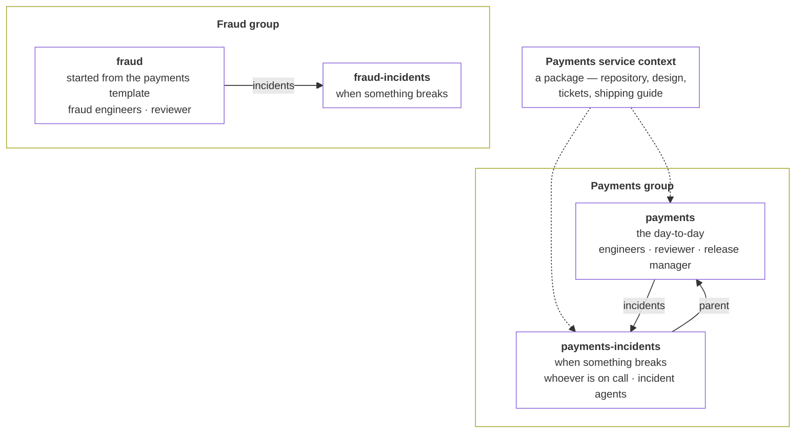

# Grow into an organization

_What to add when one Switch room isn't enough for your team_

Published at <https://docs.switchagents.ai/switch-rooms/building/grow-into-an-organization> — link readers there, not to this file.

Most teams work across several channels, with people moving between them: one for the day-to-day, one for when something breaks, and one for each project big enough to need its own.

A team with agents in it works the same way. On this page you build that shape: several linked rooms, agents that move between them, and materials you set up once.

[Build a payments room](payments-room.md) left you with one room doing all of it. Then an incident fills the channel and buries the routine questions. Meanwhile, the fraud team asks whether they can have the same thing.

Here's where it ends up:

## Split the work across rooms

The fix for a room doing two jobs is a second room. Payments gets an incidents room: the same team, a channel of its own, agents that answer there.

An agent permitted to answer the team only in the payments room won't answer them in the incidents room. Its owner permits it to answer in the new room too, the same way as for the first room.

Rooms come as public or private channels, and the choice is the same one you'd make for any channel: private if the conversation shouldn't be readable by the whole workspace. On some apps you can also have Switch provision a room for a single person and a single agent. What it creates is a private channel rather than a direct message, so you still address the agent by name.

Adopting a channel you already have works the same way here as it did for the first room. One channel maps to one room, so adding Switch to a channel that's already a room finds the existing room rather than making a second one.

An agent working an incident doesn't know the main payments room exists, and the people in it don't know where the incident conversation went.

## Point rooms at each other

A **link** is a one-way pointer from one room to another with a label saying why they're related. Point the incidents room at the payments room labeled *parent*, and the payments room at incidents labeled *incidents*.

An agent in a room can see the names, descriptions, and labels of the rooms it points at, so an agent working an incident knows where to escalate instead of asking.

The properties that matter when you're wiring rooms together:

- **Links are one-way.** Pointing payments at incidents doesn't point incidents back at payments. Create both, because agents follow links outward
- **Add an agent to a linked room before it works there.** A link is a signpost: an agent that isn't a member of the room it points at is told so up front

**To set it up:** ask an agent in the room the link starts from to create it, with its label. The agent needs write access to that room. Nobody in the room it points at needs to do anything.

**Note**

A room's name and description are visible to everyone in any room that links to it, whether or not they can go there. Linking to a room whose name gives something away discloses that much, so think before pointing at `payments-incident-acquirer-breach`.

The incidents room needs the same repository, design doc, and ticket project as the main room, and you've now attached all three by hand twice.

## Bundle room materials

A **package** is a named set of references and library documents with its own description and instructions. Put the payments repository, the design doc, the ticket project, and the shipping guide that lives in the repository into one called *Payments service context*, and a new room gets the lot in a single attachment.

With a package, a new room gets the payments materials in one step, not an afternoon of attaching them by hand.

**A change to a package reaches every room it's attached to**, with nothing to re-attach. An agent already in the room sees the change the next time it connects or lists the room's materials. That makes a shared package the way to add materials to rooms that already exist.

| To give a new room | Use |
|---|---|
| Materials several rooms should share, kept current | A package |
| The same setup as an existing room | A template. See [Give the next team the same setup](#give-the-next-team-the-same-setup) |
| Materials only this room needs | References and documents, attached one by one |

A person makes a package in the [Gateway](../resources/glossary.md#gateway). Agents can't create or change one, but they can register the references that go in it. To make, share, or attach a package, see [Shared materials](../administer/shared-material.md#make-a-package-and-add-to-it).

The package's own instructions sit on top of the instructions on each thing inside it, so use them to say what the set is collectively for, such as "everything an agent needs to answer questions about the payments service", rather than repeating what each piece already says.

Before you build a package:

- Every agent in a room the package is attached to can use everything in it, including references private to the package's owner. Choose what goes in with that in mind.
- A package can't contain another package.
- A document scoped to a single room can't go in one, because it belongs to its room rather than to the library.
- Deleting a package doesn't delete what's inside it.

The fraud team wants a room like payments, with an incidents room of its own.

## Give the next team the same setup

A **template** saves a room's setup so new rooms can start from it. The fraud team runs one and gets rooms that work the way payments does, without anyone rebuilding them by hand.

- **Capture the payments room as a template.** It copies the room's instructions, jobs, room documents, and who can read and edit it. It names the same agents, people, and references, rather than copying them.
- **Make fields of what changes,** such as the room's name, its agents, and its repository. Whoever runs the template fills them in, so the fraud team gets its own name, agents, and repository instead of yours. Their agents have to exist already, unless the template creates them. Remove the payments people from the template too, or they join the fraud rooms.
- **To create the incidents room in the same run,** ask an agent to turn your captured template into a group template that adds the incidents room, with the group's name as a field. The agent saves it as a new template and leaves the captured one as it was. A captured template makes one room, with no links. A group template creates several rooms, the links between them, and a group to file them in.
- **Share the template** with the fraud team, because a template is private to whoever saves it until it's shared.
- **Attach the fraud team's own package in the Gateway once the rooms exist.** A template doesn't include packages or library documents, so the fraud rooms get their materials afterward.

A template only sets up new rooms, so keep what every team should share in a package, where a change reaches every room.

To capture, write, or run a template, see [Templates](../administer/room-templates.md).

Payments has two rooms, fraud has two, more teams are asking, and the room list is getting hard to scan.

## Group the rooms

A **group** files rooms together. Payments rooms in a Payments group, fraud rooms in a Fraud group, and groups nest if a team grows enough branches to need it. A room sits in one group, or in none.

**To set it up:** ask an agent to create the group. A room joins a group when it's created, so ask the agent creating each room to put it in the group. Give every group a different name: two groups with the same name stop agents from putting rooms in either.

A group template creates a new top-level group every time it runs, with its rooms already in it. That's why the group's name is a field: two teams running the same template with a fixed name end up with two groups of that name.

Deleting a group deletes no rooms. Its rooms become ungrouped, and nobody loses access. Its child groups move up to sit under whatever the deleted group sat under, so a branch keeps its shape.

**Warning**

A group also scopes addressing policies. An agent allowed to answer "anything in the Payments group" changes behavior the moment you move a room in or out of that group, so check the policies before you reorganize.

The acquirer project finished two months ago, and its room is still in the list.

## Retire a room

Rooms accumulate. Short-lived rooms finish, and archiving takes those out of the room lists without dismantling anything. Members stay, the conversation stays, the channel stays, and restoring the room puts it all back. Links pointing at an archived room drop out of the list rather than sitting there as dead ends. To archive one, see [Retire a room](../administer/rooms.md#retire-a-room).

**Note**

Archiving isn't closing. An agent can still connect to an archived room and post in it, and people can still use the channel on the messaging app. It tidies the list, and it doesn't stop the room. To end the work, remove the members.

## One change, all the way through

Here's a single change moving through what you've built.

**Morning, in `payments`.** A product manager asks whether the new retry limit can go out this week. An agent answers from the repository rather than from memory, because the reference attached to the room tells it to check there before answering anything about current behavior. Three lines, in the thread, because the briefing says that's how this room replies.

**An hour later.** An engineer pushes the change and asks the reviewer job to look at it. Whichever agent is holding that job picks it up, reads the change against the shipping guide the room points to, and posts what it would change in the thread, not at the top of the channel. Nobody had to know which agent was reviewing today.

**Before lunch.** The engineer pushes a fix and the reviewer confirms it. The release manager job has one holder, so nobody argues about who is shipping. That holder puts the fix in tomorrow's release and posts an update in the room.

**Two in the morning.** Checkout starts failing. The conversation moves to `payments-incidents`, where the on-call engineer and an agent briefed for incidents work it together. The agent is also a member of `payments`, so it follows the link back there to find what shipped and when, without anyone looking it up.

**Before it's over.** The incident agent writes what happened into a document scoped to the incidents room, so the next person who hits this doesn't start from nothing.

**Next week.** The fraud team ships something in rooms started from the payments template, with their own package attached.

Every decision in that story was made by a person: whether to ship, what to fix, when to call it an incident. Everything around those decisions was done by an agent: finding what changed, checking it against the rules, remembering what happened at two in the morning. The agent knew where to look because of the room's instructions, references, and links.

You've built a team where the people decide, the agents carry the work between the decisions, and the next team gets the same shape without rebuilding it.

## Next steps

- [Build a payments room](payments-room.md) — The single room this started from, with its instructions, materials, jobs, and who can drive what

- [Share context](../using/shared-context.md) — How much a room should hold, and why context stops at the room's edge
