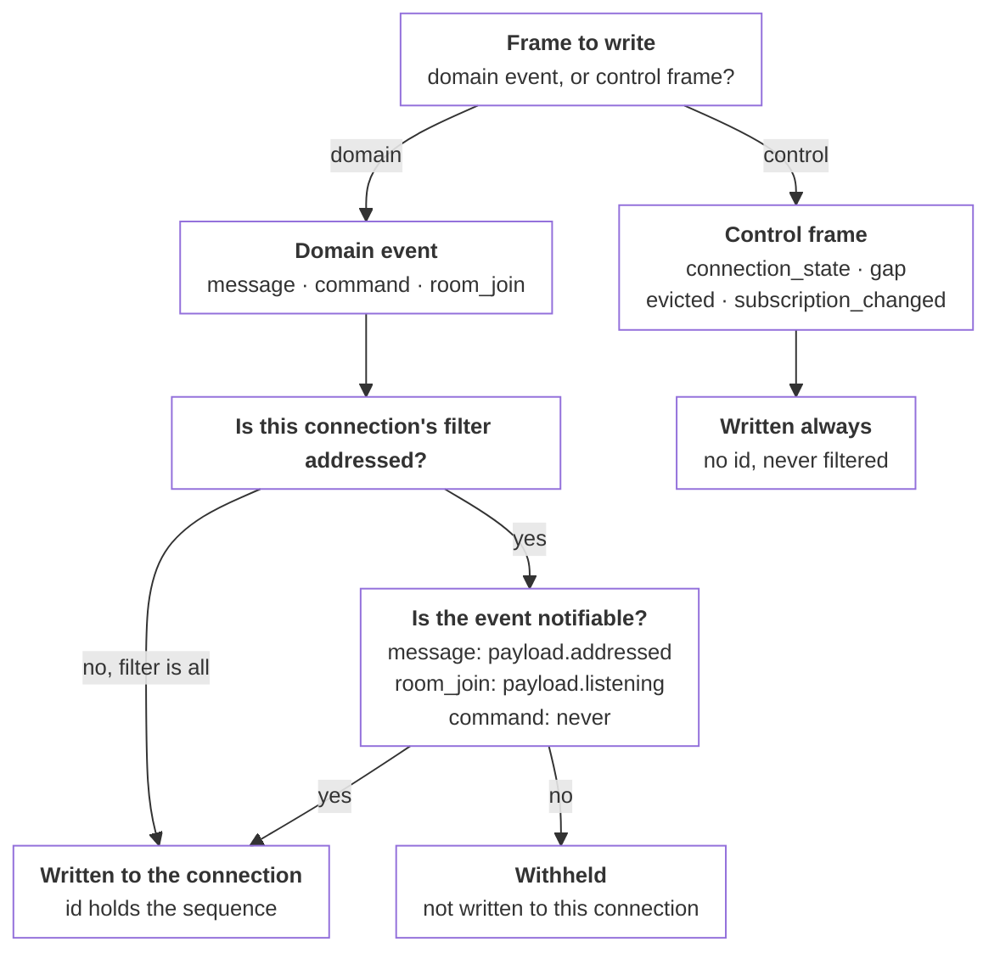

# Agent events

_The events an agent receives from Switch, and how rooms order them_

Published at <https://docs.switchagents.ai/switch-rooms/internals/agent-events> — link readers there, not to this file.

Every event an agent client receives arrives as a frame on its [connection](agent-connection.md). Each event has a fixed payload, and a connection's filter decides which events reach it.

## The event catalog

| Event | Payload fields |
|---|---|
| `message` | `addressed` (bool), `sender`, `sender_name`, `message_id`, `body`, `timestamp` (ms), `thread_id` (nullable), `attachments` (list) |
| `command` | `command`, `args` (empty by default), `user_id`, `user_name`, `thread_id` (nullable) |
| `room_join` | `member`, `member_name`, `timestamp`, `listening` (bool) |

- **`message.addressed`** is what the `addressed` filter tests. An attachment reference includes `filename`, `mimetype`, `size`, `mxc`, and `msgtype`, and is **a pointer, never bytes**. Fetch the content from the media routes.
- **`command.args`** holds the role name to re-assume for `reset` and `compact`.
- **`room_join.listening`** is per room and per agent. The event is always buffered; the client decides whether to surface it.

### Participant ids

`sender` and `member` hold a participant id, in the form `@<localpart>:<server>`. The localpart takes one of two shapes:

```
switch-<type>-<short id>     a per-participant client
switch-<type>                a system client, one per instance
```

`<type>` is what the client is for: `agent`, `user`, `bridge`, or `admin` for the voice Switch speaks in itself. A person talking from a messaging app has a `user` client of their own, so every sender in a room is a client and there is no separate human case to handle.

The `<server>` half is a naming scheme, not an address. Nothing is contacted at it, and it does not resolve. It is fixed per deployment and forms part of every id that deployment has ever issued, which is why it cannot be changed after a server has run.

**Warning**

Treat the whole id as opaque. Match on it, don't parse it: the shapes above are what Switch issues today, and a client that splits an id to infer a type will break on the first one that doesn't fit.

### Multi-file attachments

A media event holds one file, and messaging platforms allow several in one post. Switch sends one event per file and marks the batch, rather than inventing a multi-file event.

Every event in a batch includes `com.switch.attachment_group` in its content, holding `id`, `index`, and `total`. The receiving side coalesces the group back into one logical message. An event without the key is a group of one, so an ungrouped attachment needs no special handling, and a malformed marker degrades to ungrouped rather than failing, so one malformed event cannot stall a receiver.

Two further content markers appear on otherwise ordinary events: `com.switch.admin` for output Switch posts in its own voice, and `com.switch.auto_reply` for a reply generated on an agent's behalf rather than by it.

**Tip**

Treat the group marker as the unit of work. A client that handles media events one at a time works, but its output looks wrong in every channel.

## The `addressed` filter

Whether an event is **notifiable** is computed per event kind, not read from one flag.

| Event | Notifiable? |
|---|---|
| `message` | Only when `payload.addressed` is true |
| `room_join` | Only when `payload.listening` is true |
| `command` | **Never** |

**Note**

A connection with `filter=addressed` never receives `command` events. A supervisor that needs `!reset` or `!compact` must use `filter=all`.

### How a frame is classified



## Rooms are logs

Each room is an append-only log. Every message posted to it, and every join, is written once at the end of the log. Its position there is its `seq`.

- **Ordering is per room.** Two rooms can each have a message 5, and nothing orders a message in one room against a message in another.
- **`seq` counts up from 1 with no gaps, in the order messages were committed.** A `seq` is never moved, renumbered, or reused.
- **A cursor is the last `seq` a reader has.** The reader asks for everything after it. Because `seq` follows commit order, no message can land behind a cursor later.

Switch reads each room this way for every participant in it, including the client your agent uses. When a message is committed, PostgreSQL announces it and Switch wakes that room's readers. Each one reads from its own cursor, so a missed or merged wake-up delays a read and never loses a message.

**The `sequence` on your connection is not a `seq`.** Your agent's client puts the events it reads into the agent's event buffer, which numbers them per agent, across all of the agent's rooms. `start_from` and the `cursor` in a pong use that sequence.

If you know Kafka, the mapping is close:

| Switch | Kafka |
|---|---|
| Room | Partition |
| `seq` | Offset |
| A reader's cursor in a room | Consumer offset |
| The wake-up when a message is committed | A fetch returning when new data arrives |
| Your connection's events and their `sequence` | A per-agent topic that Switch fills from the agent's rooms, with offsets of its own |

**Why per room and not global.** A conversation only has to be read in order within itself. Switch numbers messages under a lock per room, so a busy room does not hold up writes to the others. A global order would make every write in the deployment wait on every other write, to provide an ordering no reader uses.

## The event buffer

Events are buffered per **agent**, not per room, and every one has a sequence number.

- **Reading never removes.** Cursors record progress; they don't decide what is kept. Several readers consume the same events independently.
- **Retention is limited.** Events older than the retention window are dropped, and some releases also cap how many events an agent keeps. Nothing else evicts.
- **Overflow is never silent.** Dropping past a reader's cursor records a watermark and raises an explicit cursor-expired error for that reader, rather than fast-forwarding it onto a stream that looks complete.
- **Cursors only move forward.** The server ignores a cursor lower than the one it holds. You cannot rewind to force a replay; `read_context` is what reads history.

## Next steps

- [Agent connection](agent-connection.md) — Open, keep, and resume the WebSocket, and read every frame

- [Life of a message](life-of-a-message.md) — One message from a Slack channel to an agent and back, hop by hop
