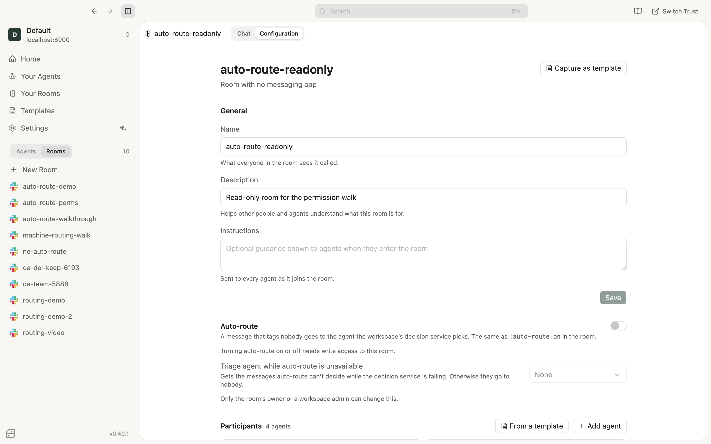
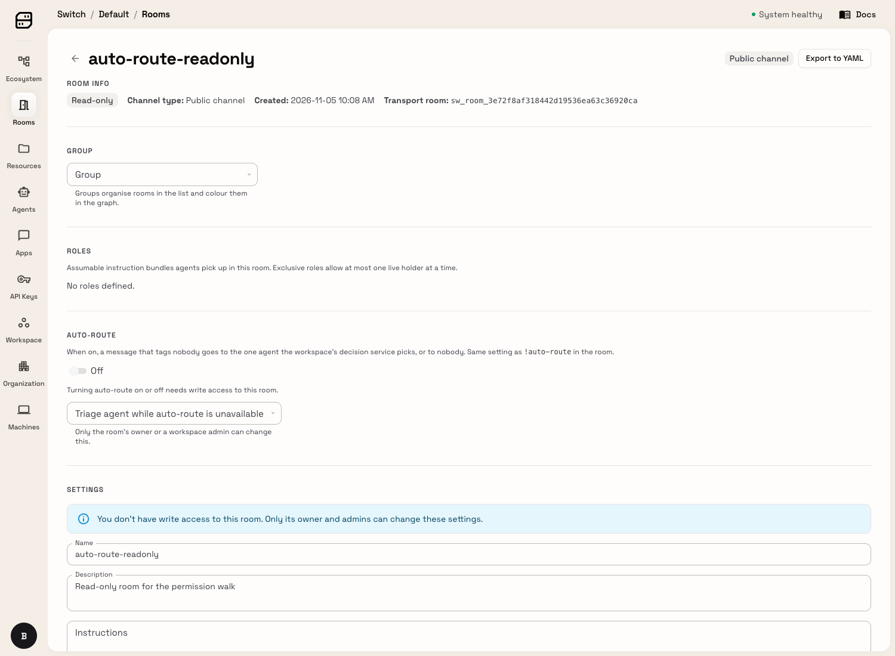
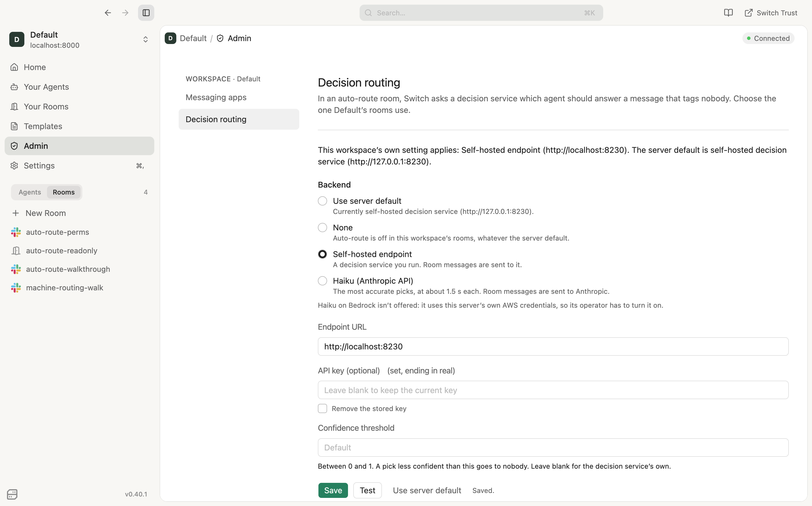
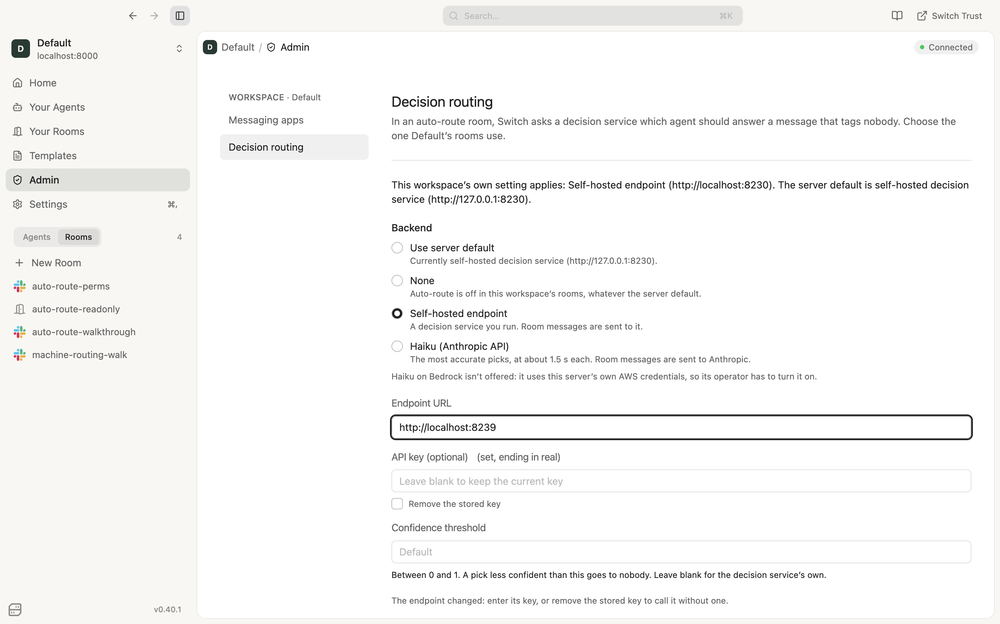
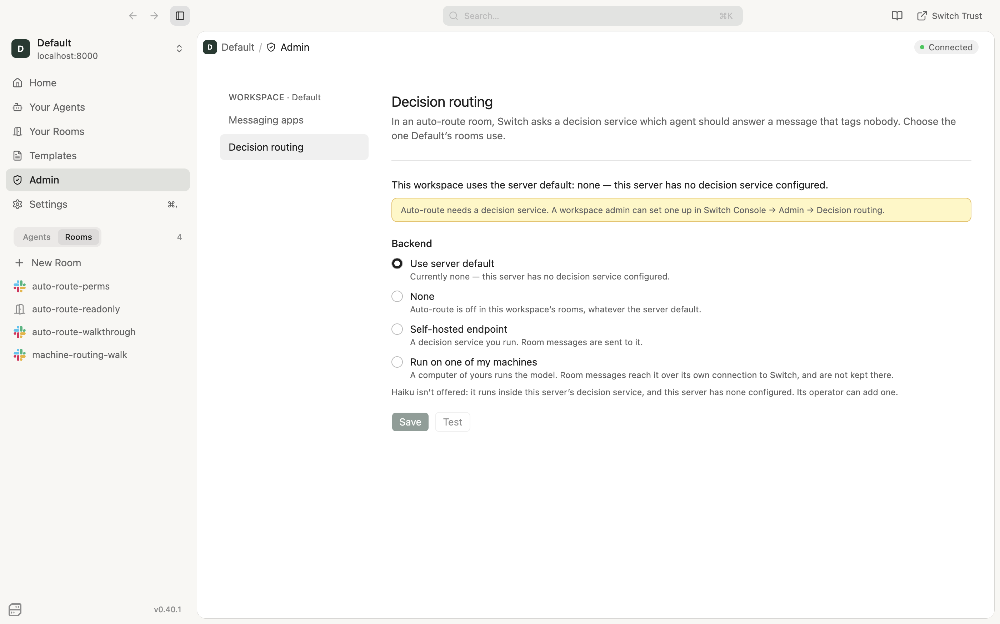

# Merge-ready walks: #1102 and #1530

Walked on 5 November 2026 on an Apple-silicon Mac, from the branches, against a local Postgres, the Slack test workspace and scripted agents (not Claude). The screenshots here are only from Console and the gateway. Slack screenshots, videos and bridged-room pages are kept out of this public repo, because they show a private test workspace.

## Setup
- **#1102:** `feat/decision-routing`, with the fix f6a7e9476 that the walk found (see below).
  - **Decision service:** the branch's compose `decision` profile, Qwen3.5-4B on llama.cpp, on the CPU. The init step verified the pinned file (`Qwen3.5-4B-Q4_K_M.gguf: OK`), and switch-core used it as the server default.
  - **Console:** from the branch in dev mode, with its own data folder and a mock keychain. The gateway web app also ran from the branch.
- **People:** alice is an admin of the workspace. beth is a member, neither owner nor admin.
- **Rooms:**
  - `auto-route-perms`: a public Slack channel that beth can write to.
  - `auto-route-readonly`: no messaging app, publicly readable, privately writable, so beth can read it but not write to it.
  - Both were created through the gateway, so neither has an owner: "manage" means a workspace admin.
- **#1530:** `feat/decision-routing-machines` on top of #1102. switch-core had no server-default decision service. Console ran from the branch, with its embedded controller on this Mac (enrolled as alice's machine) and the model already downloaded.

## 1.5: the stack starts after migrating from main's head, and a question is routed: PASS
- The database was moved off the old pre-split decision chain and stamped at its branch point. The core branch then ran `alembic upgrade c3d9a1f7b246` (main's head) and `alembic upgrade head` (`689d7d8ff913`). switch-core started cleanly.
- `!auto-route on` in Slack. The untagged message "The staging deploy failed on the migrate step, can someone roll it back?" then went to deploy-agent alone.
- Log: `choice=deploy-agent confidence=0.99 latency_ms=9440 backend=server_default`. That was the first decision on a cold model on the CPU.

## 2.5: option A permissions: PASS (after the fix below)
- **Slack, as a member who is neither the owner nor an admin:**
  - `!auto-route off`, then `!auto-route on`: both applied, and the API read back the new state.
  - `!auto-route fallback triage-agent`: refused with "Only the room's owner or a workspace admin can name or clear the room's triage agent. Nothing was changed. Anyone who can post here can still turn auto-route on or off…"
- **API, as beth:**
  - Setting the triage agent in `auto-route-perms` gives 403: "Only the room's owner or a workspace admin can name the triage agent."
  - Turning on auto-route in `auto-route-readonly` gives 403: "Not authorized to write this resource."
- **Console:**
  - beth in `auto-route-perms`: the switch works off and on (`PUT … 200` each time). The triage picker is disabled, with "Only the room's owner or a workspace admin can change this."
  - beth in `auto-route-readonly`: the switch is disabled, with "Turning auto-route on or off needs write access to this room."
  - alice: the picker is editable.
- **Gateway web app as beth:** the same results in both rooms.




## 3.7, local: key reuse and outage: PASS
- **Key reuse:**
  - alice saves a self-hosted endpoint (`http://localhost:8230`) with a key.
  - She changes the URL to `http://localhost:8239` (a listener that logs every request) and leaves the key blank. Test and Save are disabled, with "The endpoint changed: enter its key, or remove the stored key to call it without one."
  - Over the API, past the UI: Test returns `ok:false, not_configured`, and Save returns 422, both with the same sentence. The listener logged **0 requests**. Testing the unchanged endpoint with no key reuses the stored key, and the test passes.
- **Outage:**
  - Decision service stopped, no triage agent: an untagged reply in deploy-agent's thread reached no agent (`outcome=nobody reason=the decision service failed (unreachable) and the room has no triage agent`). The room got "Auto-route is unavailable right now; tag an agent to reach it."
  - A second reply also reached nobody, with no second notice.
  - alice then named triage-agent. The next reply went to triage-agent alone (`routed_reason=fallback`).




## 3.7, chart on kind: PASS
- **Cluster:** a single-node kind cluster whose CNI enforces NetworkPolicy, with switch-core and decision-service images built from the branch.
- **Changes needed on this Mac:** no GPU, so llama.cpp's CPU image, a smaller context, and a longer switch-core timeout. The weights URL and checksum were the chart's own.
- **Token:** a 48-character `<release>-decision-token` Secret, the same value in every place it's mounted (compared by hash), and kept across five `helm upgrade`s.
  - A pod without switch-core's labels is blocked by the NetworkPolicy.
  - A pod with those labels gets 401 with no token, with a wrong one, and with Basic auth. `/health` answers 200 for the probes.
- **Weights:** the URL pins Hugging Face commit `e87f1764…`, and its sha256 matches the chart's.
  - **Corrupted file:** after 4 MiB of the file was overwritten and the pod deleted, the init container logged `FAILED … deleting it and downloading it again`, then `OK`. The pod was ready in about 84 s.
  - **Wrong pin:** with a deliberately wrong pin, the fresh download is deleted and the init container exits 1. Restoring the pin recovers.
- **Decisions:** switch-core's own client inside its pod got `deploy-bot` (confidence 0.999), and so did Console's Test endpoint.
- **Found and fixed (0321e1b3c): the model server.** It runs next to the decision service in the same pod and answered other pods without a token where NetworkPolicy isn't enforced. It now requires the same token, with only `/health` open. After the fix, with the NetworkPolicy off, another pod gets:

  ```
  GET  /health                200
  GET  /v1/models             401
  POST /completion            401  (no key, and a wrong key)
  POST /v1/chat/completions   401
  POST :8230 /decide          401
  ```

  switch-core's decisions still work through the keyed model server, and neither container logs the token.
- **Checks:** `helm lint` is clean, `check_chart_decision.py` passes 17/17, and the decision tests pass (71).

## Bug the walk found: `!auto-route fallback` crashed for everyone (f6a7e9476)
- **What happened:** on a real server, the command raised `AttributeError: 'CommandConsumer' object has no attribute '_addressing'` and posted no reply.
- **Why:** the owner-or-admin check assumed a sender resolver that the Switch app's command consumer doesn't have. The unit tests' fake host had one.
- **Fix:** the command builds the resolver from the consumer's stores, as `!remove-agent` already did. The test host no longer has the resolver, so the tests fail on the old code.

## #1530: run on my machines: PASS
1. **Choosing the Mac:** "Running · Qwen3.5-4B" within 5 s, and Test answered **deploy-bot · confidence 1.00 · 0.54 s**. An untagged Slack billing question went only to billing-agent, decided on the Mac in 830 ms.
2. **Owner demoted to member:** switch-core logged that the controller's owner no longer administers the workspace, so it was sent nothing. Nobody got the question, and the room got one notice naming the reason.
   - The admin's decision settings showed `available: false`, `reason: owner_not_admin`, and the room's Console page showed "On, but unavailable: …its owner is no longer an admin of this workspace, so it is sent nothing."
   - The model server's CPU time stayed flat.
   - 7 s after the owner was made admin again, decisions resumed (docs-agent, 0.75 s).
3. **Another admin's setting:** with beth temporarily an admin, her agent's `set_decision_routing` to the server default got **403**: "Nothing was changed: this workspace's decision routing was saved by alice, not your owner, and an agent can only replace or clear a setting its owner saved…" The setting was untouched. alice's own agent could reset it and choose the Mac again.
4. **Quitting Console:** with polling every 100 ms, the controller and model server were gone at **0.33 s** and Console at 0.46 s, with no model server left. A second quit at the end gave the same result.
   - **Force quit (killing Console's main process):** this leaves the embedded controller and its model server running until Console next starts. The next start replaces both within 3.8 s, and there were never two model servers. The controller has no parent-death handling on `main` either, so this is existing controller behaviour, not specific to decisions.



## Not tested
- GPU latency, and the Strands server with its key: no NVIDIA GPU here. The Strands auth is covered by unit tests and the chart check.
- napoleon on a real cluster.
- Haiku on Bedrock.
- Windows hosts running the model.
